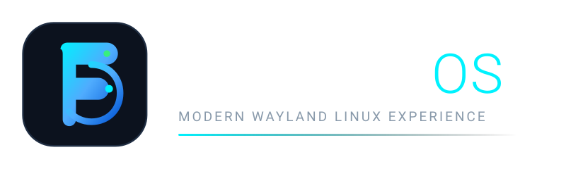

<div align="center">

# FEDORO OS
### Modern, High-Performance Linux Distribution Based on Fedora, Wayland, Hyprland & Flatpak

[](https://fedoraproject.org)
[](https://hyprland.org)
[](https://flathub.org)
[](https://gnome.org)
[](https://selinuxproject.org)
[](LICENSE)

<br/>



<br/>

**FEDORO OS** is an operating system crafted for developers, creators, and enthusiasts who demand modern visual aesthetics, tear-free Wayland performance, intuitive workflows, and the rock-solid reliability of Fedora Linux.

</div>

---

## 🌟 Key Highlights

- **Pure Wayland & Hyprland Compositor**: Fluid physics-based animations, hardware-accelerated blur, dynamic tiling, and multi-monitor fractional scaling.
- **Robust Base (Fedora + DNF5)**: Latest Linux kernel, cutting-edge Mesa graphics drivers, systemd service management, and SELinux in **Enforcing** mode.
- **Universal Sandboxed Applications**: Native **Flatpak** integration with **Flathub**, isolating user applications from core operating system packages.
- **Native Libadwaita Suite**: Custom native GTK4 utilities built specifically for Fedoro:
  - `fedoro-welcome`: Interactive first-boot tour and system onboarding.
  - `fedoro-settings`: Visual display, scaling, wallpaper, theme, and keybinding management.
  - `fedoro-store`: Graphical Flatpak app store for discovering and installing software.
- **Familiar & Intuitive Keybindings**: Easy transition for users migrating from Windows or macOS.
- **Reproducible Build Pipeline**: Declarative Fedora Kickstart architecture supporting isolated, rootless containerized builds via Podman.

---

## 🖥️ Desktop Preview & Aesthetic

Fedoro OS introduces a signature visual language:
- **Color Palette**: Deep Midnight Slate (`#0c121e`), Sapphire Blue (`#0052d4`), and Vibrant Neon Cyan (`#00f2fe`).
- **Typography**: Clean, readable sans-serif typography powered by *Inter* and *JetBrains Mono*.
- **Glassmorphism**: Subtle, GPU-accelerated background blur for Waybar, Rofi, and SwayNC without compromising frame rates.

Wallpapers are located in `branding/wallpapers/`:
- `fedoro-default-dark.png` (4K UHD Dark Theme)
- `fedoro-default-light.png` (4K UHD Light Theme)

---

## ⌨️ Essential Keyboard Shortcuts

| Shortcut | Action | Description |
|---|---|---|
| **`Super + Space`** | App Launcher | Open Rofi application search |
| **`Super + Return`** | Terminal | Launch default terminal emulator |
| **`Super + E`** | File Manager | Open Nautilus file explorer |
| **`Super + B`** | Web Browser | Open Firefox |
| **`Super + I`** | Fedoro Settings | Open System & Display Preferences |
| **`Super + S`** | Fedoro Store | Launch Flatpak Software Center |
| **`Super + W`** | Fedoro Welcome | Launch Welcome & Setup Onboarding |
| **`Super + Q`** | Close Window | Close currently focused window |
| **`Super + F`** | Fullscreen | Toggle window fullscreen mode |
| **`Super + V`** | Floating Mode | Toggle window floating state |
| **`Super + L`** | Lock Screen | Lock session via `hyprlock` |
| **`Super + Shift + S`**| Screenshot | Capture area to clipboard & file |
| **`Super + 1..9`** | Workspaces | Switch to workspace 1 through 9 |
| **`Super + Shift + 1..9`**| Move Window | Move active window to workspace |
| **`Super + Escape`**| Power Menu | System shutdown, reboot, suspend, logout |

---

## 📂 Repository Structure

```
fedoro/
├── README.md                      # Primary project overview
├── LICENSE                        # GNU General Public License v3.0
├── .gitignore                     # Git ignore definitions
├── docs/                          # Technical Architecture & Operations
│   ├── architecture.md            # In-depth system architectural blueprint
│   ├── installation.md            # Hardware specs, USB flashing, UEFI boot
│   ├── development.md             # Developer workflow & environment setup
│   ├── troubleshooting.md         # NVIDIA, PipeWire, and Portal guides
│   └── release-process.md         # QA checklist and ISO release guidelines
├── build/
│   ├── kickstart/
│   │   ├── fedoro-base.ks         # System authorization, locale, disk layout
│   │   ├── fedoro-packages.ks     # Complete curated RPM package manifest
│   │   └── fedoro-live-hyprland.ks# Master Live ISO kickstart & post-install
│   ├── scripts/
│   │   ├── check-deps.sh          # Pre-flight host dependency verifier
│   │   ├── flatten_ks.py          # Kickstart flattener & pykickstart validator
│   │   ├── build-iso.sh           # Master build orchestration script
│   │   ├── run-container-build.sh # Podman containerized ISO builder
│   │   ├── verify-checksums.sh    # SHA256 & SHA512 hash generator
│   │   └── test-iso-qemu.sh       # QEMU UEFI virtual machine test harness
│   └── output/                    # Generated ISO images and checksums
├── desktop/
│   ├── hypr/                      # Modular Hyprland configs (input, look, rules, lock)
│   ├── waybar/                    # Status bar config and custom CSS styling
│   ├── launcher/                  # Rofi launcher and power menu
│   ├── notifications/             # SwayNotificationCenter & Mako configs
│   └── themes/                    # GTK & Qt theme preferences
├── branding/
│   ├── assets/                    # Vector SVG logos and badges
│   ├── icons/                     # Vector and PNG icons (256x256, 64x64)
│   ├── wallpapers/                # 4K UHD Dark & Light default wallpapers
│   ├── os-release                 # /etc/os-release branding definition
│   ├── issue                      # TTY issue banner
│   └── motd                       # Message of the Day banner
├── applications/
│   ├── welcome/                   # Fedoro Welcome GTK4/Adwaita onboarding app
│   ├── settings/                  # Fedoro Settings desktop preferences app
│   └── store/                     # Fedoro Store Flatpak application center
└── tests/
    ├── test_syntax.sh             # Shell script and Python syntax checks
    ├── test_desktop_configs.sh    # JSON, JSONC, and Hyprland config validator
    ├── test_kickstart.sh          # Kickstart directive verification
    └── test_applications.py       # Automated unit tests for GTK4 apps
```

---

## 🛠️ Quick Start & Build Instructions

### 1. Run Pre-flight Dependency Check
Verify that all development tools and libraries are installed:
```bash
./build/scripts/check-deps.sh
```

### 2. Run the Full Test Suite
Validate shell scripts, Python syntax, desktop JSON/JSONC configs, Kickstart directives, and run application unit tests:
```bash
./tests/test_syntax.sh
./tests/test_desktop_configs.sh
./tests/test_kickstart.sh
python3 -m unittest tests/test_applications.py
```

### 3. Dry-Run Build Verification
Validate Kickstart resolution and staging without starting the ISO generation:
```bash
./build/scripts/build-iso.sh --dry-run
```

### 4. Build Live ISO (Containerized via Podman)
Build the live installation media safely inside an isolated container:
```bash
./build/scripts/build-iso.sh
```

### 5. Boot and Test in Virtual Machine (QEMU)
Once generated, test boot the ISO with hardware acceleration:
```bash
./build/scripts/test-iso-qemu.sh build/output/Fedoro-OS-Live.iso
```

---

## 🔒 Security & Reliability Principles

1. **SELinux in Enforcing Mode**: Fedoro OS retains Fedora's default MAC (Mandatory Access Control) policies.
2. **Unprivileged Desktop**: The compositor and user interface execute strictly under standard unprivileged accounts. Administrative operations are authenticated via Polkit (`polkit-gnome`).
3. **Application Sandboxing**: By prioritizing Flatpak, user-facing applications run isolated from the core operating system, preventing accidental corruption of system libraries.
4. **Zero Proprietary Bloat**: Fedoro ships only necessary open-source components with explicit documentation for opting into proprietary NVIDIA drivers and codecs.

---

## 📄 License

Fedoro OS configurations, custom applications, and build recipes are released under the [GNU General Public License v3.0](LICENSE).
Fedora® is a registered trademark of Red Hat, Inc. Fedoro OS is an independent community project.
